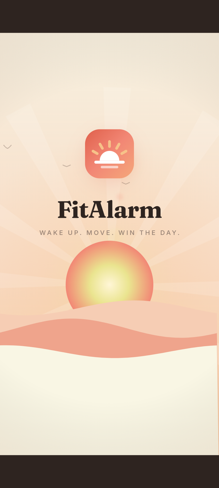
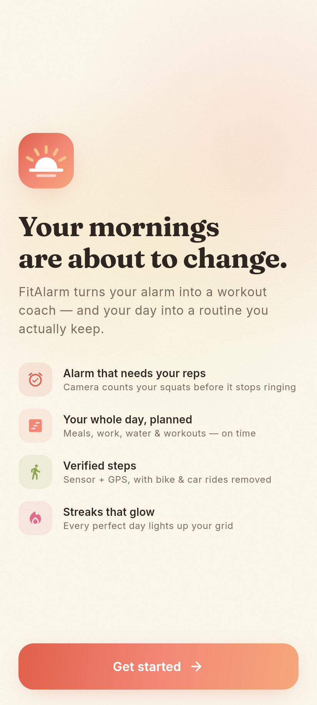
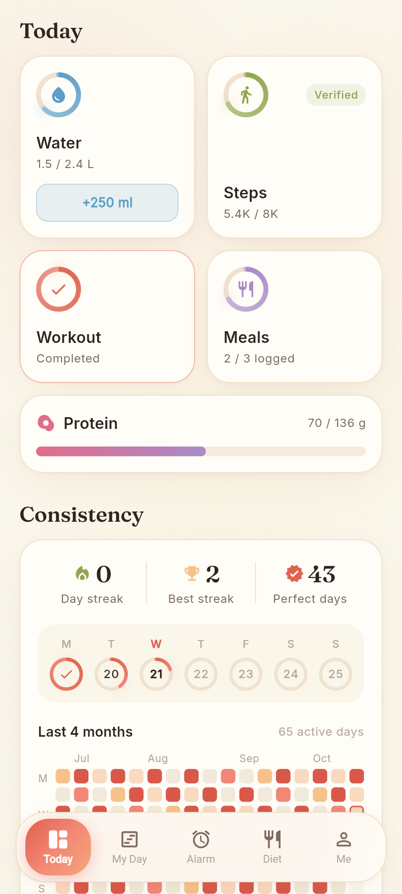
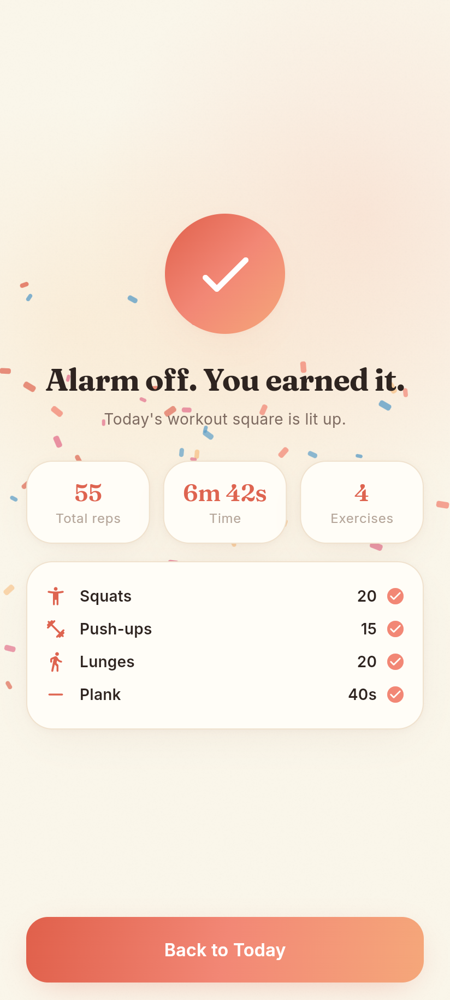

# FitAlarm (working name)

An alarm that only stops when you've done your workout. The phone camera counts your reps. The app also includes a full daily-routine planner, verified step counting, diet planning, food scanning and a LeetCode-style streak heatmap.

<p>
  
  
  
  
</p>
<p>
  
  
  
  
</p>

## Roadmap

| Phase | Scope | Status |
|---|---|---|
| 1 | App shell, premium design system, onboarding, health targets, home dashboard, streak heatmap | ✅ Done |
| 2 | Workout alarm: full-screen alarm and camera pose detection (ML Kit) with rep counting, custom routines | ✅ Built, needs device testing |
| 3 | My Day routine maker and scheduled reminders | ⏳ Next |
| 4 | Dual step counter (sensor + GPS, vehicle filtering) and water reminders | |
| 5 | Diet plans, custom goals with deadlines, meal logging | |
| 6 | Food camera scanner (AI nutrition estimate) | |
| 7 | Badges, XP, weekly reports, friends, Play Store release | |

## Tech

- **Flutter** (Android first), Riverpod for state, go_router for navigation
- Look: "Golden hour" palette (Salmon, Peach, Candy corn, Pale, Linen), Fraunces serif headings with Inter body text
- Cinematic touches: letterbox splash opening with a title that tracks in, a sunrise scene with a slow camera push-in, lens flares and film grain, and screen transitions that pull focus from blurred to sharp
- flutter_animate for motion, with custom painters for the progress rings, aurora background and heatmap
- Fonts (Inter + Fraunces) are bundled in `assets/google_fonts` and work offline
- Health maths in `lib/features/profile/domain/health_targets.dart`: Mifflin-St Jeor BMR, TDEE, macros, fiber, water and stride length

## Project layout

```
lib/
  core/            theme, router, shared widgets (GlassCard, ProgressRing, Pressable…)
  features/
    splash/        animated launch screen
    onboarding/    11-step animated onboarding with ruler pickers
    home/          "Today" dashboard
    streaks/       daily log, scoring, streak maths, heatmap widget
    profile/       user profile model, targets, profile screen
    alarm/         alarms tab, editor, scheduler (alarm plugin), ring screen, permissions
    workout/       exercises, routines, rep counters, camera + ML Kit pose, workout & done screens
    shell/         floating glass bottom navigation
test/              unit tests (targets, streaks) and full onboarding flow tests
```

## How the workout alarm works

1. The alarm rings through the `alarm` plugin as a full-screen alarm with looping sound and vibration. The notification has no stop button, and swiping it away or killing the app does not stop it.
2. The ring screen only offers **Start workout**. The **Emergency stop** needs a 3-second hold plus a maths question.
3. During the workout, the ring is silenced and a **watchdog alarm** is set for 90 seconds later. Every rep pushes it back. If the user stops moving or leaves the app, it rings again.
4. The front camera feeds ML Kit pose detection on the phone itself. `lib/features/workout/domain/rep_counter.dart` turns joint angles into reps, using thresholds with hysteresis, smoothing and a minimum time per rep.
5. Alarm options: 4 ringtones with preview, volume, gradual fade-in, vibration, limited snooze (0–3× of 3/5/10 min), skip next, duplicate, swipe-to-delete with undo, and **Hard mode** (no snooze, no emergency stop).
6. When every exercise is done, the alarm is cleared, today's workout counts toward the streak, and repeating alarms are set for their next day.

### Testing on a phone
- Use a real Android phone. Emulators have no usable camera for pose detection.
- On first launch, allow notifications, alarms & reminders, camera, and "ignore battery optimisation".
- Some brands (Xiaomi, Oppo, Vivo, Samsung…) also need **Autostart** enabled for the app in system settings, or alarms may not fire while the app is closed.

## Run it

```bash
flutter pub get
flutter run            # on an Android device or emulator
flutter test           # unit + widget tests
```
