# FittiePi (working name)

An alarm that only stops when you've done your workout. The phone camera counts your reps. The app also includes a full daily-routine planner, verified step counting, diet planning, food scanning and a LeetCode-style streak heatmap.

<p>
  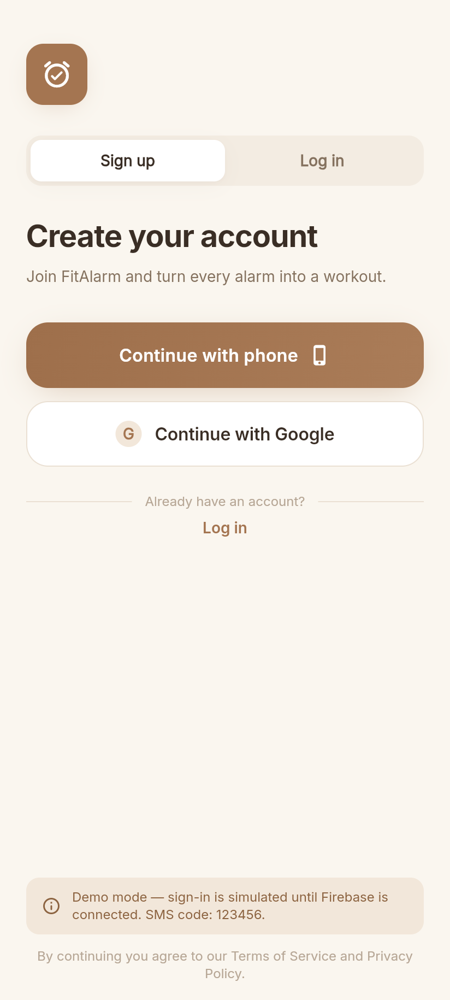
  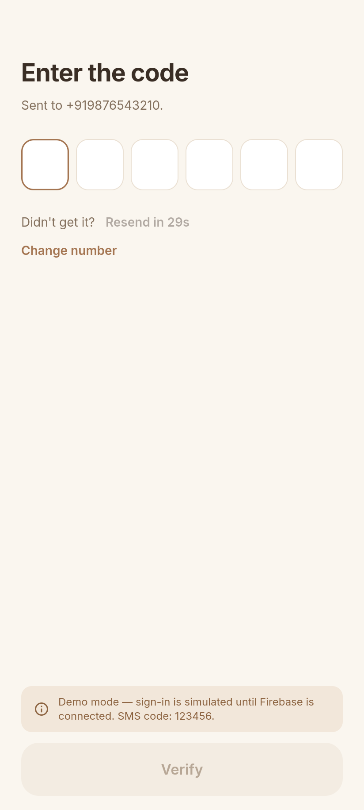
  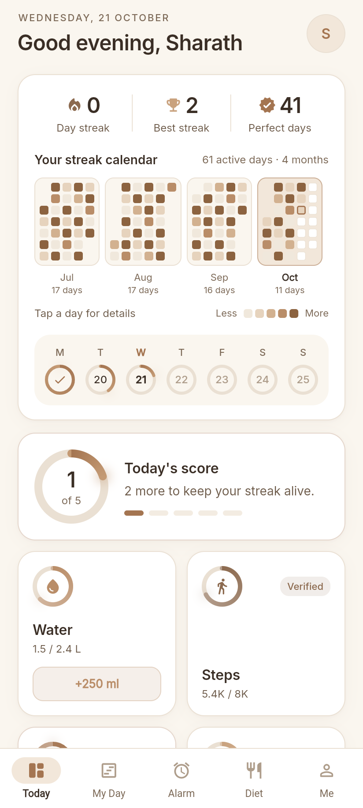
  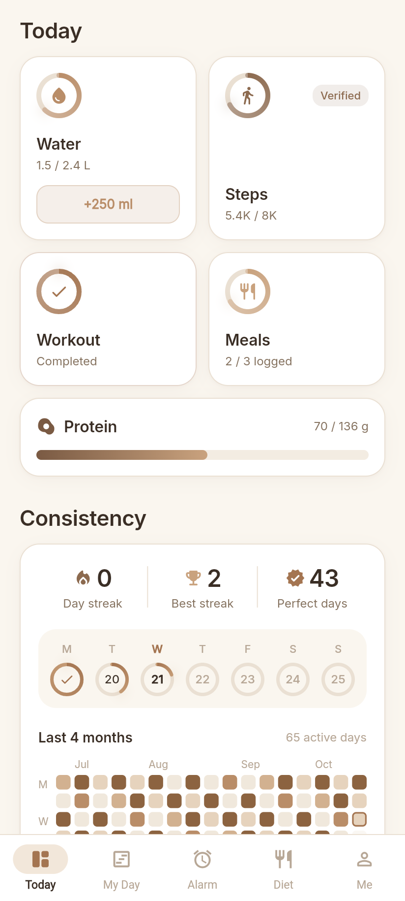
</p>
<p>
  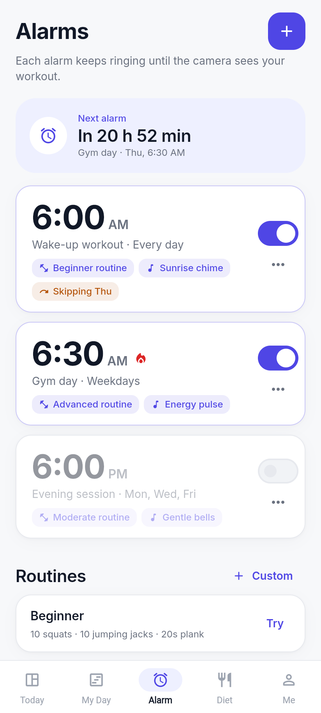
  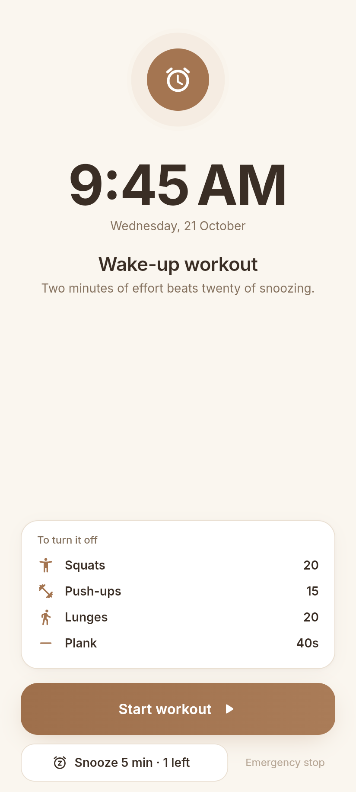
  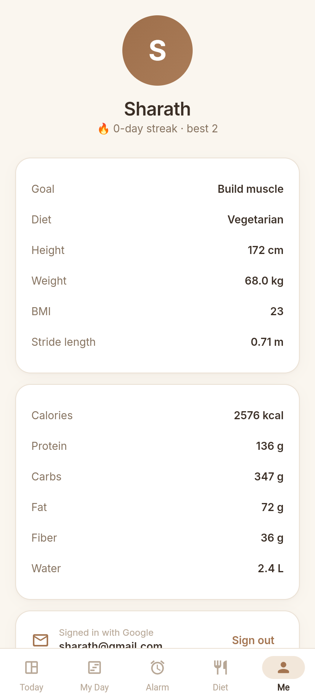
</p>
<p>
  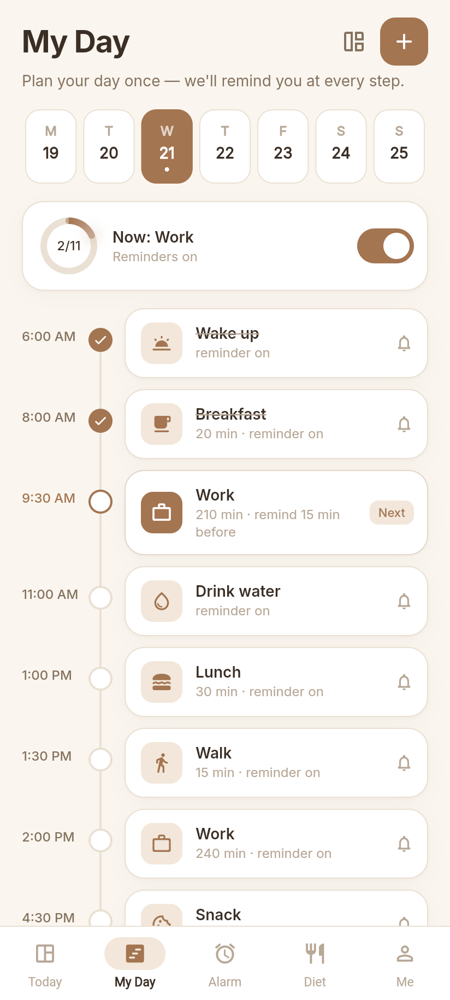
  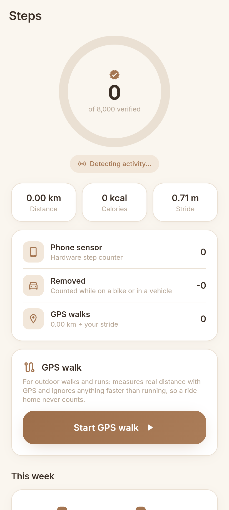
  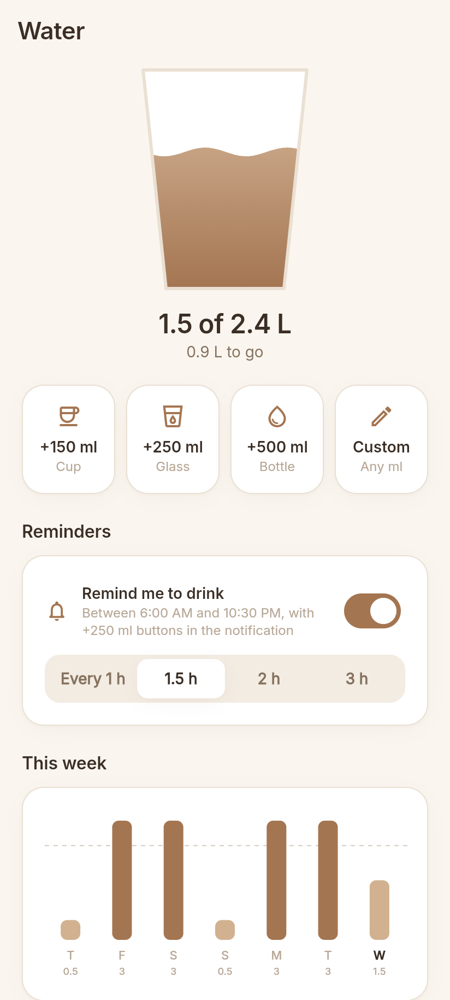
</p>
<p>
  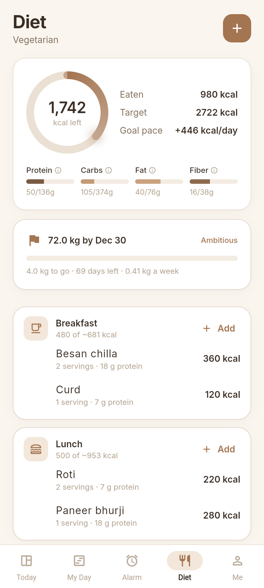
  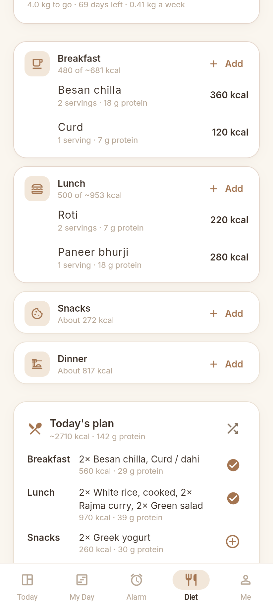
  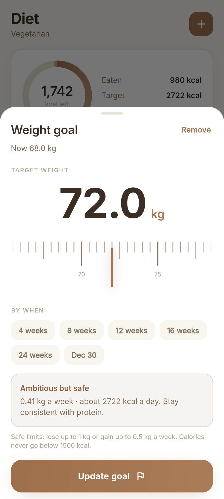
</p>
<p>
  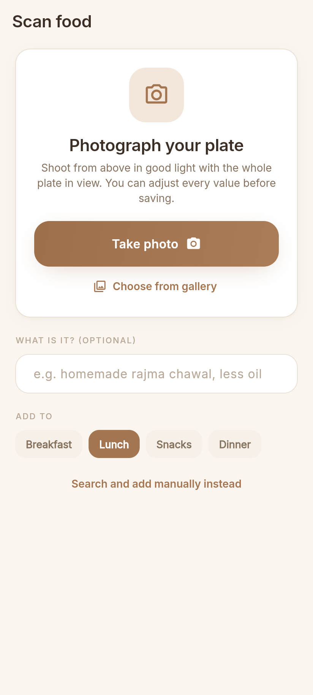
  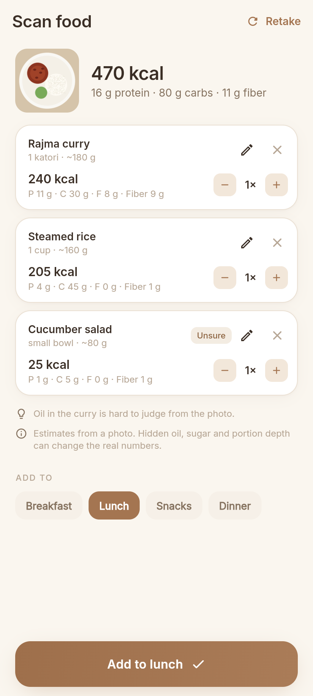
  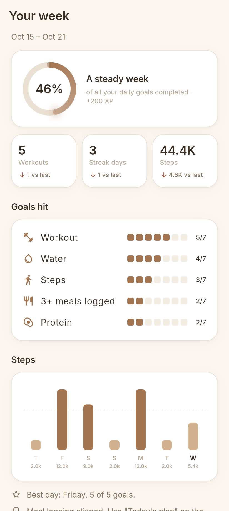
  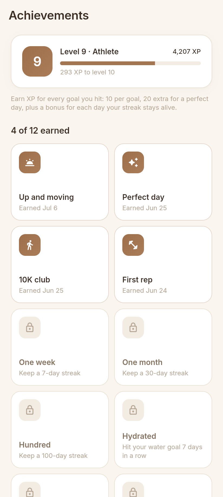
</p>
<p>
  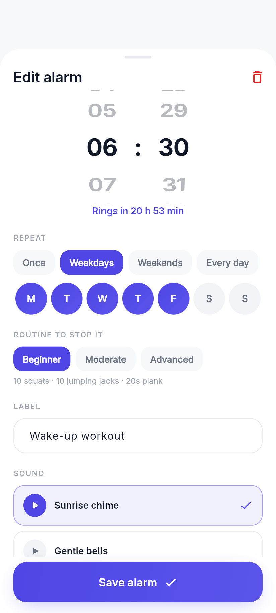
  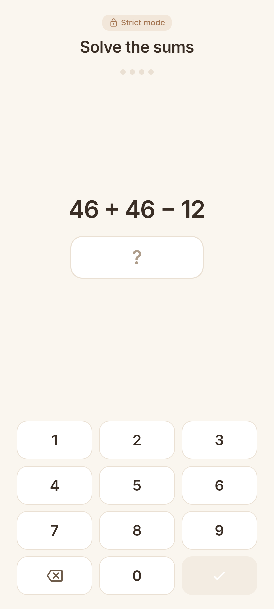
  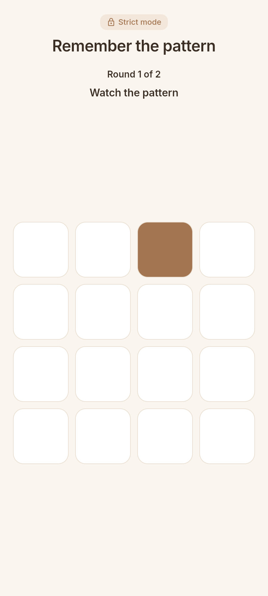
</p>

## Roadmap

| Phase | Scope | Status |
|---|---|---|
| 1 | App shell, premium design system, onboarding, health targets, home dashboard, streak heatmap | ✅ Done |
| 2 | Workout alarm: full-screen alarm and camera pose detection (ML Kit) with rep counting, custom routines | ✅ Built, needs device testing |
| 3 | My Day routine maker and scheduled reminders | ✅ Built, needs device testing |
| 4 | Dual step counter (sensor + GPS, vehicle filtering) and water reminders | ✅ Built, needs device testing |
| 5 | Diet: calorie and macro targets, meal logging, daily meal plans per diet, weight goal with a deadline, explainers | ✅ Done |
| 6 | Food camera scanner: on-device dish recognition (free, offline) → nutrition from the built-in food list | ✅ Built, needs device testing |
| 7 | XP and levels, 12 achievements, weekly report, privacy policy, account deletion, release signing and Play checklist | ✅ Done |

## Tech

- **Flutter** (Android first), Riverpod for state, go_router for navigation
- Look: light cream, light brown and white only, with Inter throughout
- Opening: the Android launch screen shows the logo tile, then the app draws the clock and check onto it, the name rises in letter by letter, and the logo flies into place on the sign-in screen (see `docs/screenshots/opening_animation.png`)
- Sign-in: steps slide in with a shared-axis transition, and a drawn check with a greeting confirms success
- Motion is otherwise kept quiet: short fades, small rises, press feedback and progress rings that animate to their value
- flutter_animate for motion, with custom painters for the progress rings, aurora background and heatmap
- Fonts (Inter) are bundled in `assets/google_fonts` and work offline
- Health maths in `lib/features/profile/domain/health_targets.dart`: Mifflin-St Jeor BMR, TDEE, macros, fiber, water and stride length

## Project layout

```
lib/
  core/            theme, router, shared widgets (GlassCard, ProgressRing, Pressable…)
  features/
    splash/        animated launch screen
    onboarding/    11-step animated onboarding with ruler pickers
    home/          "Today" dashboard
    streaks/       daily log, scoring, streak maths, heatmap widget
    profile/       user profile model, targets, profile screen
    alarm/         alarms tab, editor, scheduler (alarm plugin), ring screen, permissions
    workout/       exercises, routines, rep counters, camera + ML Kit pose, workout & done screens
    myday/         daily routine timeline, templates and reminders
    steps/         step sensor + activity recognition + GPS walks
    water/         water log and reminders
    diet/          food list, meal log, meal-plan generator, weight goal, diet screen and sheets
    scan/          on-device food recognition (TensorFlow Lite) and the scan screen
    progress/      XP, levels, achievements, weekly report
    shell/         bottom navigation
test/              unit tests (targets, streaks) and full onboarding flow tests
```

## How the diet planner works

- **Targets** come from the profile (Mifflin-St Jeor TDEE, protein per kg for the goal, 25% fat, carbs for the rest, 14 g fiber per 1,000 kcal).
- **Weight goal with a deadline**: the needed pace is (target − current) ÷ weeks left. Daily calories change by pace × 7,700 ÷ 7, capped at 1 kg/week loss or 0.5 kg/week gain, and never below 1,200 (women) or 1,500 (men) kcal. Too-fast goals are flagged with the date the safe pace would reach them.
- **Meal plans** are built per day from Indian-style meal ideas that fit the user's diet (vegan, veg, eggetarian, non-veg), favouring higher-protein options, with servings scaled to each meal's share of calories. *Shuffle* gives another combination; each meal can be logged with one tap.
- **Logging** uses a built-in list of ~70 common foods (per serving) plus custom foods. Each change updates the day's meals and protein, which feed the score and streak calendar.
- Tap any macro, or the *Learn the basics* cards, for a plain-language explainer.

## How the food scanner works

Tap the camera on the Diet tab and take or choose a photo. Google's free AIY Food V1 model (TensorFlow Lite, about 2,000 dishes including many Indian ones) runs on the phone, so scanning costs nothing, works offline, and the photo never leaves the device. The app shows its best guesses with a confidence score. The likely one is added for you, and tapping another adds it too. Nutrition comes from the app's food list. You set the portion (½× to 3× servings), because a single photo can't measure amounts reliably. Dishes the model knows but the food list doesn't open the search pre-filled.

The model isn't stored in git: the APK build downloads it into `assets/models/` (see `assets/models/README.md`). Without it the scanner offers manual entry instead.

## XP, achievements and the weekly report

- **XP** comes from your history, so nothing extra is stored: 10 per daily goal hit, +20 for a perfect day, plus a streak bonus (+1 per streak day, capped at +30). Levels need 0, 100, 300, 600, 1000… XP.
- **12 achievements**, from "First rep" to "Hundred" (a 100-day streak). Each is stamped with the day it was earned, and a quiet notice appears when you unlock one.
- **Weekly report** (Home → *Your week*): completion ring, workouts, streak days and steps compared with last week, goals hit per day, a steps chart, your best day and one suggestion for the goal you missed most.

## Release

See `docs/RELEASE.md` for signing, the Play Console forms (including data safety) and the device test checklist. The privacy policy is in `docs/PRIVACY.md` and in the app under Me → Privacy policy.

## Strict mode and brain games

Each alarm chooses how it is turned off: a **workout** on camera, or a **brain game** for mornings when the goal is to be awake and studying. The games are maths, memory (repeat a tile pattern) and number order (tap 1, 2, 3… in a shuffled grid), or mixed. Each comes in easy, medium or hard, and the editor has a "Try it" button.

**Strict mode**, a per-alarm toggle, keeps the alarm going until the task is finished:
- Full volume from the first second. The volume keys can't lower it.
- No snooze and no emergency stop.
- Full screen. Leaving the app (Home, recents, another app) brings the alarm straight back. This needs "Display over other apps", which the app asks for when you turn strict mode on.
- The screen is pinned where Android allows it.
- If the phone is switched off, the alarm rings again after it restarts.

Limits: no app can block the power button or a forced restart, because Android reserves those for the system. Strict mode makes the alarm come back instead. If the camera isn't available, a strict workout alarm can still be turned off with hard brain games.

## How the workout alarm works

1. The alarm rings through the `alarm` plugin as a full-screen alarm with looping sound and vibration. The notification has no stop button, and swiping it away or killing the app does not stop it.
2. The ring screen only offers **Start workout**. The **Emergency stop** needs a 3-second hold plus a maths question.
3. During the workout, the ring is silenced and a **watchdog alarm** is set for 90 seconds later. Every rep pushes it back. If the user stops moving or leaves the app, it rings again.
4. The front camera feeds ML Kit pose detection on the phone itself. `lib/features/workout/domain/rep_counter.dart` turns joint angles into reps, using thresholds with hysteresis, smoothing and a minimum time per rep.
5. Alarm options: 4 ringtones with preview, volume, gradual fade-in, vibration, limited snooze (0–3× of 3/5/10 min), skip next, duplicate, swipe-to-delete with undo, and **Hard mode** (no snooze, no emergency stop).
6. When every exercise is done, the alarm is cleared, today's workout counts toward the streak, and repeating alarms are set for their next day.

### Testing on a phone
- Use a real Android phone. Emulators have no usable camera for pose detection.
- On first launch, allow notifications, alarms & reminders, camera, and "ignore battery optimisation".
- Some brands (Xiaomi, Oppo, Vivo, Samsung…) also need **Autostart** enabled for the app in system settings, or alarms may not fire while the app is closed.

## Sign-in (phone OTP + Google)

Signed-out users see **Sign up / Log in** with *Continue with phone* (6-digit SMS code) or *Continue with Google*.

Until Firebase is connected the app runs in **demo mode**: a banner says so, any phone number works with code `123456`, and Google returns a sample account. To turn on real sign-in:

1. Create a project at [console.firebase.google.com](https://console.firebase.google.com) and add an **Android app** with package name `com.fitalarm.fitalarm`.
2. Add your debug and release **SHA-1 and SHA-256** fingerprints (`cd android && ./gradlew signingReport`). Phone and Google sign-in both need them.
3. Download **google-services.json** into `android/app/`. The build picks it up automatically.
4. In *Authentication → Sign-in method*, enable **Phone** and **Google**.
5. For phone sign-in on real devices, also enable the **Play Integrity API** for the project in Google Cloud.

## Run it

```bash
flutter pub get
flutter run            # on an Android device or emulator
flutter test           # unit + widget tests
```
